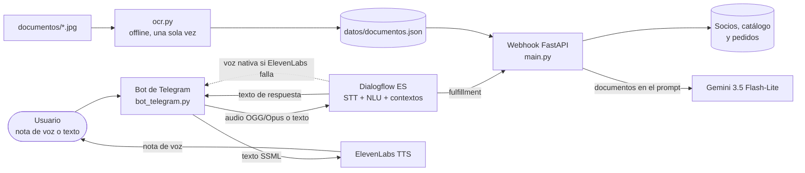

# Paco "Cartucho": asistente de voz de una tienda de videojuegos retro

**Evaluación final de Herramientas de IA Clásica** · Máster en Inteligencia Artificial, Cloud Computing y DevOps (PontIA)

Autor: **Guillermo Parés Marín**

## Caso de uso

**Game Non Stop** es una tienda de videojuegos retro (NES, Super Nintendo, Mega Drive, Game Boy, Nintendo 64) atendida por **Paco "Cartucho"**, un dependiente friki de los 90. El cliente le habla por **notas de voz de Telegram** y Paco responde también con voz. Puede **reservar un juego** (flujo de varios turnos con confirmación sí/no), **consultar el estado de un pedido**, recomendar clásicos y **responder dudas de la tienda** (devoluciones, garantía, tasación de usados, club de socios, precio de consolas) leyendo cuatro documentos escaneados con OCR. Si la respuesta no está en esos documentos, lo dice en vez de inventársela.

> Todos los datos de la tienda (socios, teléfonos, pedidos, precios y reglas) son inventados.

## Arquitectura



El elemento central es el agente de Dialogflow; el resto se integra a su alrededor:

- **Voz de entrada**: Dialogflow transcribe el audio (STT nativo), dentro de la misma llamada que detecta la intención.
- **Voz de salida**: ElevenLabs (voz diseñada para Paco, acento peninsular). Si falla, se usa la voz nativa de Dialogflow.
- **Webhook**: lógica de negocio en código, no en plantillas.
- **OCR**: se ejecuta **antes** de levantar el webhook. Dentro de la petición no cabría en los 5 s que da Dialogflow.

## Intenciones

| Intención | Propósito | Respuesta |
|---|---|---|
| `Default Welcome Intent` | Saludo de Paco y menú de lo que sabe hacer | Fija, en SSML |
| `reservar_juego` | Reservar un juego. Parámetros obligatorios: `@juego`, `@plataforma`, `@telefono`. Abre el contexto `ctx_reserva` (lifespan 5) | **Webhook** |
| `reservar_juego - yes` | Confirma la reserva. Cierra `ctx_reserva` (lifespan 0) | Fija, con los datos del contexto |
| `reservar_juego - no` | Cancela la reserva. Cierra `ctx_reserva` | Fija |
| `consultar_pedido` | Estado de un pedido según el teléfono del socio | **Webhook** |
| `consulta_tienda` | Dudas de devoluciones, garantía, tasación, club y consolas | **Webhook → Gemini + documentos OCR** |
| `consultar_horario` | Horario y dirección | Fija |
| `recomendar_juego` | Recomienda un clásico (varias respuestas aleatorias) | Fija |
| `despedida` | Cierre de la conversación | Fija |
| `Default Fallback Intent` | Lo que no encaja en nada | **Webhook → Gemini + documentos OCR** |

**Entidades**: `@plataforma` y `@juego` (sinónimos, con variantes habituales del reconocimiento de voz) y `@telefono`, de tipo **regex**: `[67]([\s-]?\d){8}` (móvil español; admite espacios y guiones).

**Contexto**: en el flujo de reserva, `ctx_reserva` guarda juego, plataforma y teléfono. Los follow-ups `yes`/`no` solo se disparan con ese contexto activo, así que un «sí» suelto no confirma nada.

### Caminos del webhook en `reservar_juego`

1. El teléfono no tiene formato de móvil español.
2. El teléfono no es de un socio.
3. El juego no existe para esa consola (se le dice para cuál sí) o está agotado.
4. Todo correcto: precio y pregunta de confirmación.

En los tres primeros el webhook cierra el contexto (`lifespan 0`) para que un «sí» posterior no confirme una reserva fallida.

## Decisiones técnicas

- **OCR con Tesseract y preprocesado medido.** Se compararon 6 variantes de preprocesado frente al texto original de los documentos:

  | Preprocesado | Similitud media | Números perdidos |
  |---|---|---|
  | Escala de grises (versión base) | 95,5 % | 3 |
  | **Grises + autocontraste (elegida)** | **98,4 %** | **0** |
  | Ampliar 2x | 98,2 % | 1 |
  | 2x + autocontraste | 98,3 % | 1 |
  | Binarizar | 98,0 % | 10 |
  | 2x + binarizar | 98,4 % | 0 |

  Con solo grises, Tesseract leyó `15/09/2826` (por 2026), `509 puntos` (por 500) y `tz meses` (por 12): un error de OCR acaba siendo una respuesta falsa del bot. Se eligió la variante más simple con cero errores.
- **Validación con regex en dos sitios.** La entidad `@telefono` filtra en Dialogflow y el webhook vuelve a validar el teléfono con `re`. Sobre el texto del OCR se extraen fechas, importes y referencias (`REF-SNES-001`) con regex y se guardan junto al texto.
- **Documentos en el prompt, sin base vectorial.** Son 4 documentos cortos y caben enteros en el prompt. Se descartaron un RAG con base vectorial y la Knowledge Base de Dialogflow por innecesarios para este tamaño.
- **Control de alucinaciones.** El prompt obliga a responder solo con los documentos y a devolver exactamente `NO_LO_SE` si el dato no está. El webhook sustituye ese marcador por una frase fija de Paco. Prueba con 10 preguntas: 5 respondibles (5 correctas) y 5 sin respuesta en los documentos (5 con la frase fija: Bitcoin, PS5, Dreamcast, teléfono de la tienda y el tiempo).
- **Si el LLM falla o tarda.** El webhook usa un límite propio de 3,5 s (`asyncio.wait_for`), porque la API de Gemini no admite timeouts de cliente menores de 10 s. Si se supera o hay error, Paco responde con una frase fija y nunca deja el silencio.
- **Modelo Gemini.** `gemini-3.5-flash-lite` (0,5-2,2 s). `gemini-3.8-flash` devolvía errores 503 por saturación y `gemini-2.5-flash` ya no admite claves nuevas.
- **Telegram con polling.** El bot pregunta a Telegram por mensajes nuevos, sin URL pública propia. El `session_id` de Dialogflow es el chat de Telegram y `/start` lo renueva, de modo que cada chat tiene su propio contexto.
- **Voz.** El STT es el nativo de Dialogflow (audio OGG/Opus a 48 kHz, tal cual llega de Telegram, sin conversión). La respuesta se sintetiza con ElevenLabs (`eleven_multilingual_v2`) a partir del SSML del agente, conservando las pausas. Si ElevenLabs falla, se envía el audio nativo de Dialogflow.
- **Latencia por turno de voz** (medida en Telegram): 4,1 s, 4,2 s y 5,1 s en tres turnos (el último, una reserva que pasa por el webhook). Desglose: Dialogflow ~0,7-1 s; ElevenLabs 1,5 s con `eleven_multilingual_v2` frente a 0,6 s con `eleven_flash_v2_5`. Se mantuvo el modelo multilingüe por la calidad de la voz, asumiendo que algún turno roza los 5 s.

## Mejoras opcionales incluidas

- **Telegram** como canal, con notas de voz de ida y vuelta (sin tarjetas ni botones).
- **TTS de terceros**: ElevenLabs, con una voz diseñada con *Voice Design* (no es clonación de voz).

## Estructura del repositorio

```
├── main.py                  # Webhook FastAPI: reservas, pedidos y respuesta documental
├── ocr.py                   # OCR offline + regex → datos/documentos.json
├── generar_documentos.py    # Crea los 4 documentos "escaneados" (Pillow)
├── bot_telegram.py          # Telegram ⇄ Dialogflow ⇄ ElevenLabs
├── documentos/              # Los 4 documentos (JPG)
├── datos/documentos.json    # Texto y campos extraídos por el OCR
├── agente/paco-cartucho.zip # Export del agente de Dialogflow
├── requirements.txt
└── .env.example
```

## Cómo ejecutarlo

### Requisitos previos
- Python 3.11 y **Tesseract OCR** instalado **con el paquete de idioma español** (en Windows, el instalador de UB Mannheim, marcando *Spanish* en *Additional language data*).
- Un proyecto de Google Cloud con la **Dialogflow API** habilitada y un agente de **Dialogflow ES** en español.
- Una **cuenta de servicio** con el rol *Dialogflow API Client* y su clave JSON.
- Una **API key de Gemini** (Google AI Studio), un **bot de Telegram** (@BotFather) y una cuenta de **ElevenLabs** con una voz propia (no de la biblioteca) y su API key.

### Pasos

```bash
python -m venv venv
venv\Scripts\activate            # Windows
pip install -r requirements.txt
cp .env.example .env             # y rellena las claves
```

1. **Agente**: en Dialogflow, *Settings → Export and Import → Restore from ZIP* con `agente/paco-cartucho.zip`. Activa el Text-to-Speech en *Settings → Speech*.
2. **OCR** (una sola vez, antes del webhook): `python ocr.py`. Los documentos de ejemplo ya están en `documentos/`; con `python generar_documentos.py` se regeneran.
3. **Webhook**: `uvicorn main:app --reload --port 8000`. Publica el puerto 8000 con visibilidad **pública** (túnel de VS Code, ngrok o similar), y pega la URL acabada en `/webhook` en *Fulfillment*.
4. En *Fulfillment* de cada intención, activa **Enable webhook call for this intent** en: `reservar_juego`, `consultar_pedido`, `consulta_tienda` y `Default Fallback Intent`.
5. **Bot**: `python bot_telegram.py`, y escribe a tu bot en Telegram (`/start`, o manda una nota de voz).

### Datos de prueba

| Socio | Teléfono | Pedido |
|---|---|---|
| Guillermo | `600111222` | Mega Drive reacondicionada, en camino |
| Miyamoto | `611222333` | Zelda, listo para recoger |
| Hideo Kojima | `622333444` | Pack Game Boy, pendiente de pago |
| Akira Toriyama | `633444555` | Sin pedidos |

Juegos agotados para probar ese camino: **Castlevania (NES)** y **Kirby's Dream Land (Game Boy)**.

## Limitaciones conocidas

- La reserva confirmada no se guarda en ningún sitio: los datos de tienda son diccionarios en memoria.
- El túnel público de desarrollo se atascó en alguna ocasión (1 de 12 peticiones en una prueba); con un despliegue estable no ocurriría.
- Las respuestas por voz tardan entre 4 y 5 s por turno, en el límite de lo pedido.
